# Fuel Supply Intelligence & Resilience Platform (FSIP)

[](https://github.com/ShahriarParib/Bio-Fuel/actions/workflows/ci.yml)


**BUP CSE FEST 2026, Final Hackathon.** An autonomous, resilience-first decision-support platform for the organizers'
simulated Bangladeshi fuel network (`asifmahmoud414/bup-fuel-supply-simulator:1.0.0`). It monitors live telemetry,
predicts stockouts 10 hours ahead, plans dispatches using rolling-horizon Linear Programming under every physical
constraint, executes safely with human-in-the-loop or guarded autopilot, and self-heals when its own dependencies fail.

> **SIMULATED ENVIRONMENT.** All numbers, screenshots, and evidence reports are measured against the official
> deterministic simulator image. No real fuel infrastructure is accessed or controlled.

---

## Live Demos & Engineering Journal

### 1. Local Machine Demo — Full Walkthrough (With Voice Explanation)
Narrated page-by-page walkthrough running locally on Docker Compose (WSL2) covering Overview, LP optimization & Advisory approval, Risk/N-1/Fairness, Crisis & Chaos resilience, Grafana observability, and Poridhi Puku CLI:

https://github.com/user-attachments/assets/b5957997-3f8d-4b16-9278-3f03e42c27f6

### 2. Cloud Deployment Demo (Poridhi Playground + Load Balancer)
Live clean-clone deployment running inside a Poridhi cloud sandbox (`docker compose` across 7 containers on 3.8 GB RAM) and exposed publicly via **Poridhi Load Balancer** (`100.80.134.219:3005`):

https://github.com/user-attachments/assets/a1b903fc-24f7-4033-a3ac-8cd084e480c6

| Poridhi Load Balancer Endpoint Mapping |
| :---: |
| 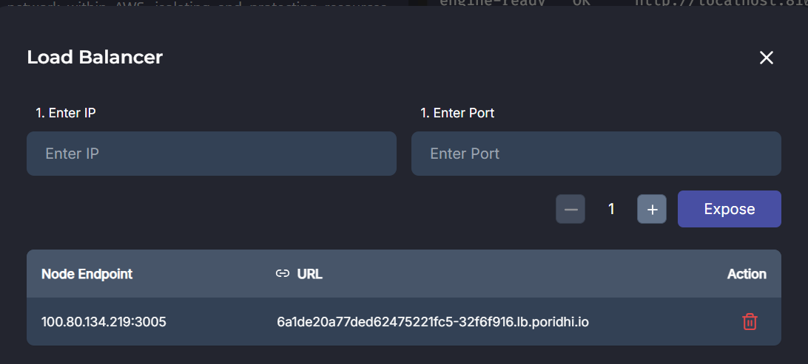 |

> **Full 15-Page Engineering Journal (PDF):** [FSIP_Full_Engineering_Journal.pdf](docs/FSIP_Full_Engineering_Journal.pdf) ·
> [Markdown Source](docs/ENGINEERING_JOURNAL.md) ·
> [Demo Runbook](docs/demo-runbook.md) ·
> [Poridhi Puku CLI Evaluation (19/20)](docs/evidence/puku-cli-evaluation.md)

---

## Key Numbers at a Glance

| Demand Served (Normal / Crisis) | Fuel Lost (Failed / Overflow) | Chaos Resilience Drills | Kubernetes Self-Heal & Scale |
| :---: | :---: | :---: | :---: |
| **31% &rarr; 100%** *(Normal)*<br>**26% &rarr; 99%** *(Combined Crisis)* | **0 Failed Shipments**<br>**0 Litres Overflow** *(All 15 runs)* | **11 / 11 Pass**<br>*Detect 0.6–9.1 s · Recover 0–25.2 s* | **7 s** pod replacement<br>**2 &rarr; 6** API pods @ 300 VUs (**0 5xx**) |

---

## Results (measured, reproducible)

| Question | Measured Answer | Evidence |
|---|---|---|
| Does it help? | 3 simulated days: **31 % &rarr; 100 %** demand served (normal), **26 % &rarr; 99 %** (crisis: demand spike + supply cut + route cut + supply delay + station outage) | [evaluation.md](docs/evidence/evaluation.md) |
| Does it ever make things worse? | **0 failed shipments and 0 litres lost to overflow** across every scenario and policy | [evaluation.md](docs/evidence/evaluation.md) |
| When fuel truly runs out, is it fair? | Optimizer lifts worst-served station from **0.87 &rarr; 0.92** (6-day baseline) at equal total service; reports **Jain Fairness Index** (0.9997 live) & binding constraint (`supply` vs `distribution` vs `approval`) | [fairness.md](docs/evidence/fairness.md) |
| How early does it warn? | First stockout warning **40 ticks (10 h)** before first stockout; structural forecast **5.8 % WAPE** vs 4.5–5.8 % simulator noise floor | [journal B3](docs/ENGINEERING_JOURNAL.md) |
| What if one asset fails? | Every route, depot, and station removed in turn and replayed closed-loop in **190–430 ms**: worst single failure costs **7,783 L**; two stations have **no second route** | [contingency.md](docs/evidence/contingency.md) |
| What if dependencies break? | **11 / 11 failure drills pass**: detected in **0.6–9.1 s**, unattended recovery in **0–25.2 s** | [resilience.md](docs/evidence/resilience.md) |
| Can I see it? | 4 Grafana dashboards (as code), 16 alerts, 4 SLOs including a **domain SLO (fuel service level &ge; 99 %)** | [observability.md](docs/evidence/observability.md) |
| Does it hold load? | k6 through nginx: api &times;3 holds 2–4&times; load of &times;1; 10 &rarr; 300 VU spike at **17.7 ms p95**, **0 errors**, engine **0 ticks behind** | [loadtest-report.md](docs/evidence/loadtest-report.md) |
| Does it keep itself running? | Kubernetes (Helm + kind): killed pod replaced in **7 s** on labelled fallback; API autoscales **2 &rarr; 5–6 replicas** under 300 VUs (**0 5xx**, **7.7–8.1 ms p95**); single-writer invariant asserted in CI | [kubernetes.md](docs/evidence/kubernetes.md) |
| Can a non-engineer read it? | Plain-language recommendation explanations, shift handovers, and incident postmortems; strict grounding guard rejects any invented number | [assistant.md](docs/evidence/assistant.md) |
| How does Poridhi Puku CLI perform? | Auto-discovers `PUKU.md`; scored **19 / 20** across 4 deep codebase & SRE evaluation benchmarks with exact line citations | [puku-cli-evaluation.md](docs/evidence/puku-cli-evaluation.md) |
| Can it be shipped safely? | CI runs lint + 240 unit tests &rarr; real simulator e2e &rarr; Chromium browser smoke (19 checks) &rarr; decision gate &rarr; Trivy &rarr; GHCR + **CycloneDX SBOM** + **cosign**; `deploy.sh` auto-rolls back bad releases in **9 s** | [ci.yml](.github/workflows/ci.yml), [clean-clone.md](docs/evidence/clean-clone.md) |

---

## Operator Console & Visual Proof

### Core Operations Flow
1. **Overview**: live KPIs, network topology with in-flight trucks, station fuel bars, and the **Impact Meter** (exact do-nothing counterfactual replay).
2. **Recommendations**: brief §9 format showing inventory, projected stockout, recommended shipment, *stockout risk before &rarr; after*, plus expandable signals, constraints, and alternatives.
3. **Risk & Alerts**: 300-path Monte Carlo stockout heatmap, N-1 contingency scan, Jain fairness index, and explained vs unexplained demand anomalies.
4. **Decisions & Control**: full audit trail with idempotency keys, live simulator clock, domain crisis presets, and chaos fault injection.

| Overview (Live Network + Impact Meter) | Recommendation Reasoning & Constraints |
|---|---|
| 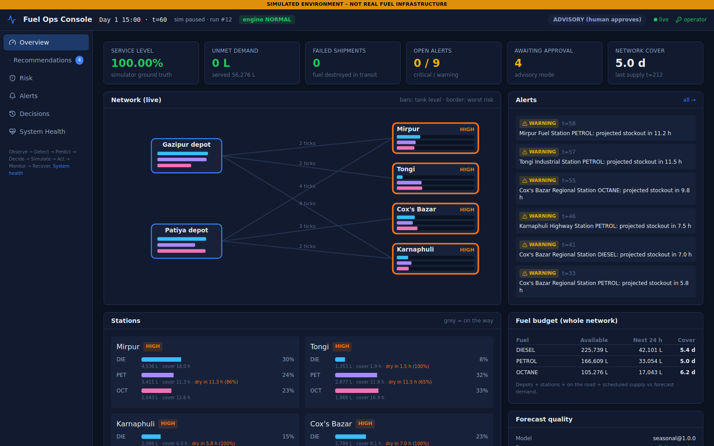 | 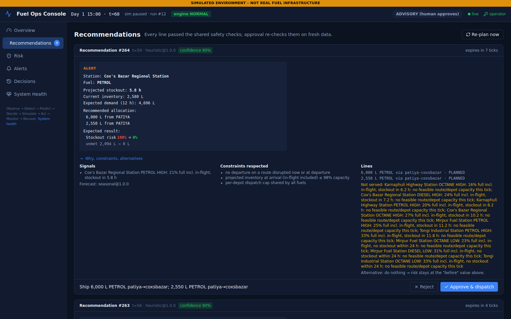 |
| **Monte Carlo Risk Heatmap** | **Decisions Audit Trail (Post-Approval)** |
| 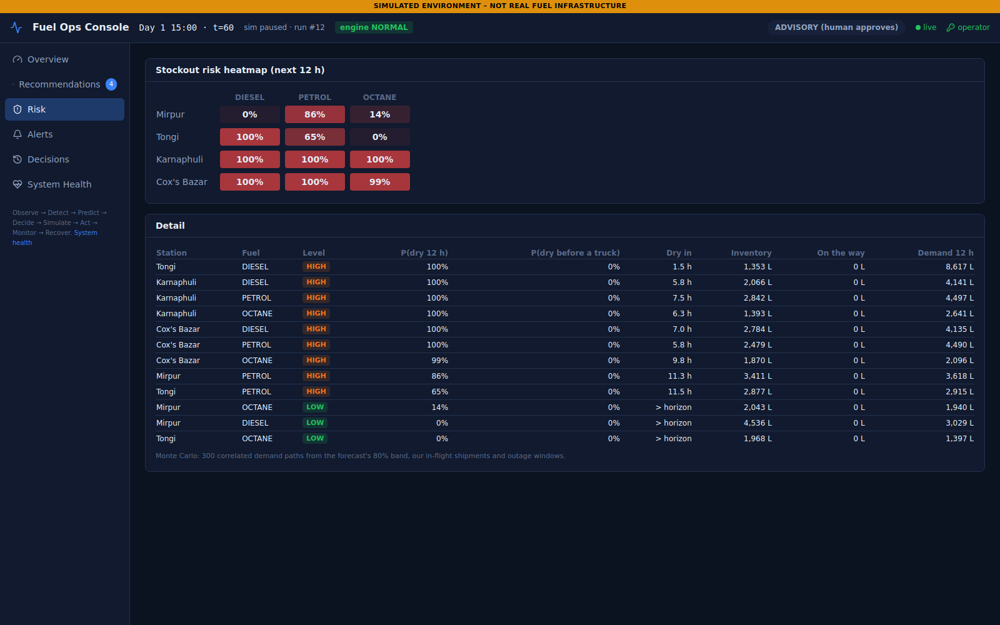 | 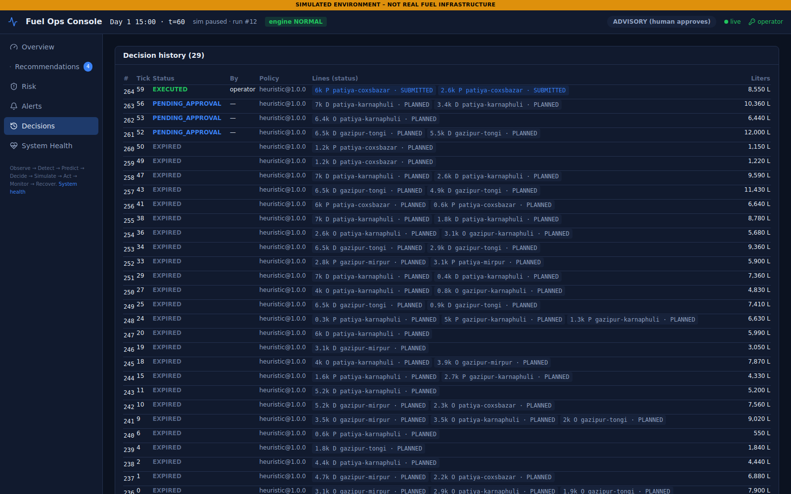 |

### Intelligence, Contingency, Fairness & Grounded AI

| N-1 Contingency Scan (Closed-Loop Twin) | Scarcity & Jain Fairness Index |
|---|---|
| 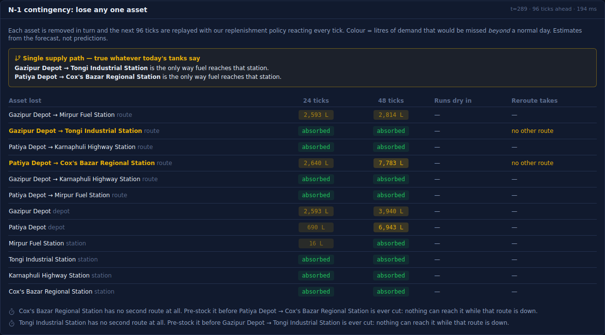 | 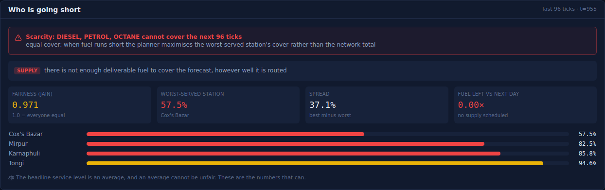 |
| **Grounded AI Decision Explanation** | **Grounded AI Incident Postmortem** |
|  | 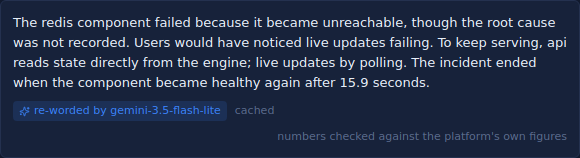 |

<details>
<summary><strong>Click to expand: System Health, Chaos Drills, Alerts, Control & Grafana Dashboards (8 more screenshots)</strong></summary>

| System Health & Resilience Contract | Grafana Service Health During Drill |
|---|---|
| 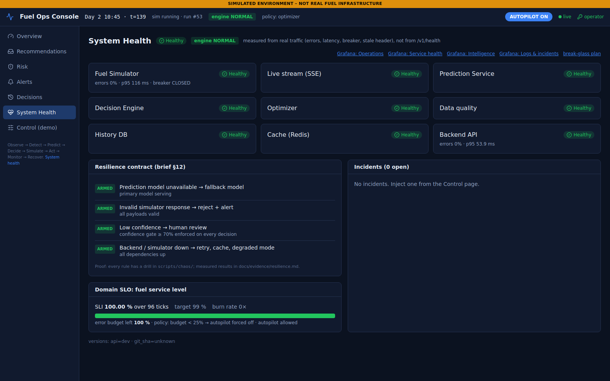 | 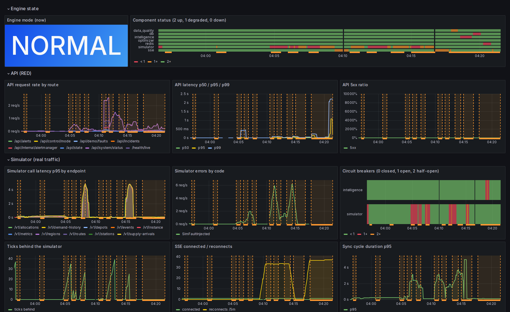 |
| **Grafana Ops Overview (Under Fault)** | **Grafana Ops Overview (Auto-Recovered)** |
| 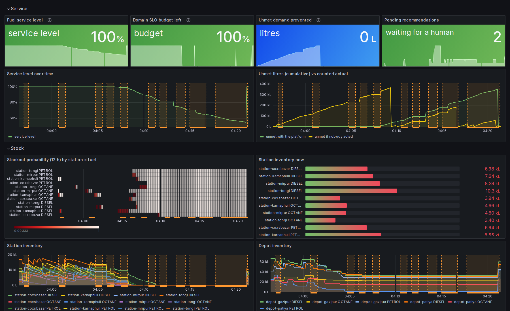 | 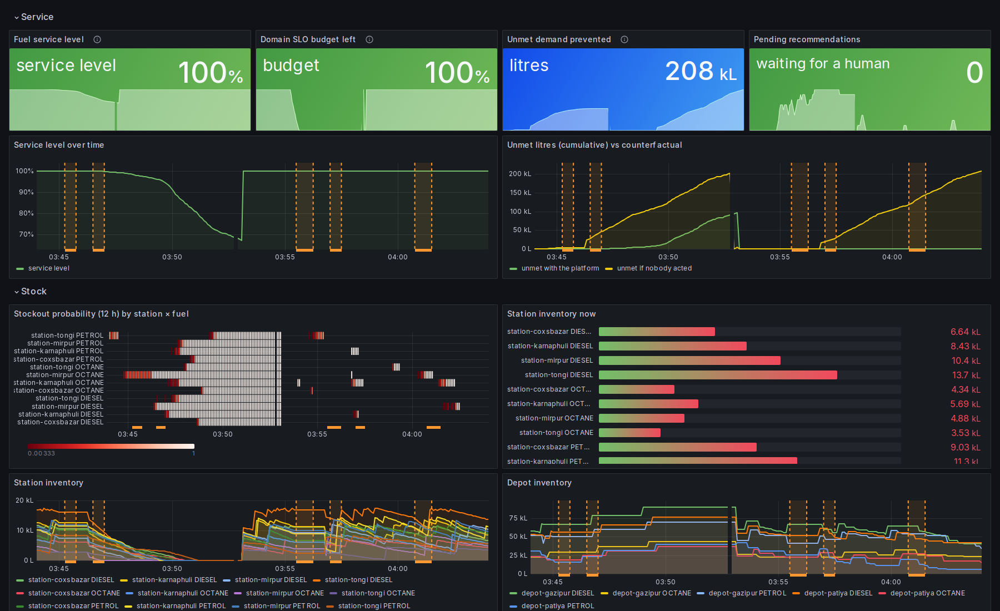 |
| **Grafana Intelligence (Forecast & Fallback)** | **Loki Logs & Incident Timeline** |
| 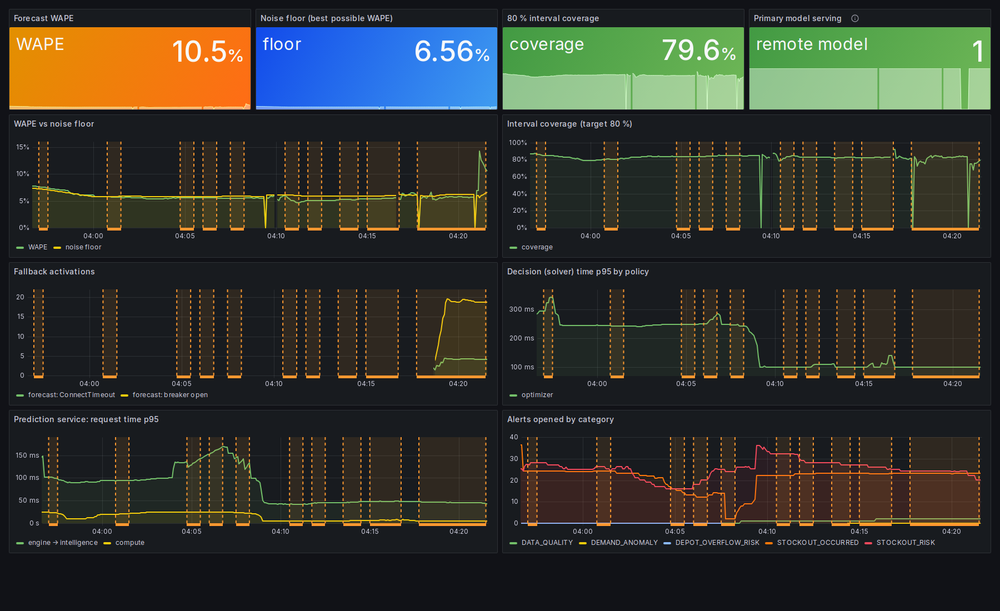 | 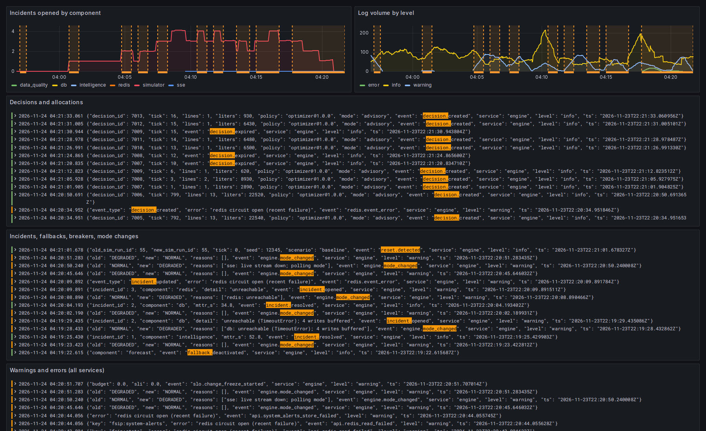 |
| **Alerts (Anomaly & Prometheus Webhook)** | **Demo Control & Brief §23 Story Director** |
| 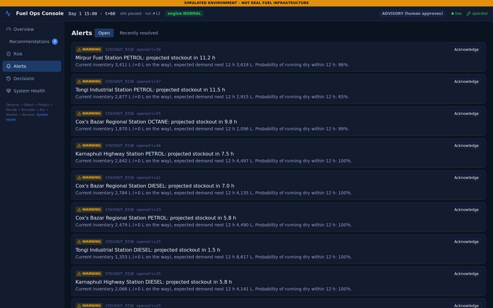 | 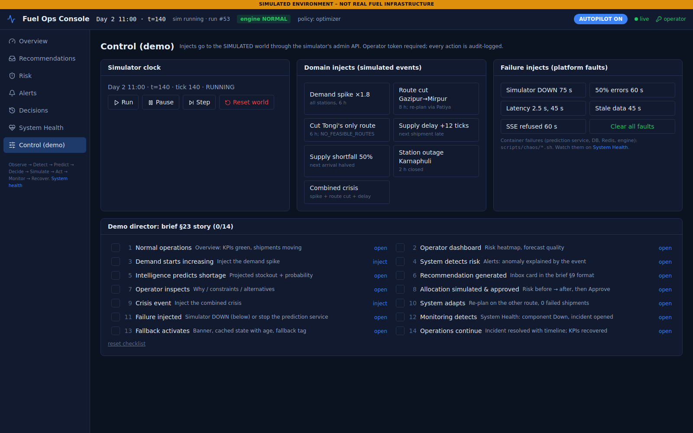 |

</details>

---

## Engineering Journal Highlights: What Broke & Why It Changed the Design

Rather than trusting documentation or happy-path unit tests, we reverse-engineered the simulator image and ran destructive chaos drills against the live Docker stack. Every finding below is backed by a test or drill in [docs/ENGINEERING_JOURNAL.md](docs/ENGINEERING_JOURNAL.md):

### 1. Undocumented Simulator Physics We Measured
- **`/v1/health` ignores faults:** It keeps answering `"ok"` while real calls return 503s — so `HealthMonitor` judges component health strictly from **live traffic** (breaker state, 30 s error ratio, p95, stale header).
- **In-flight arrival overflow is silently destroyed:** The simulator checks only *current* station inventory. Our planner enforces `room_at_arrival()` (`decision/constraints.py`) combining projected inventory, fuel already on the way, and pessimistic **p10** demand (capped at `0.98` capacity).
- **Departure-tick route cuts destroy fuel:** A disruption starting at the departure tick marks the allocation `FAILED` with no refund, while mid-transit disruptions are harmless. We block departures whenever a non-resolved disruption overlaps `[t, t+1]`.
- **Shared depot dispatch caps & closed stations:** Dispatch limits reset per tick across *all* fuels at a depot; closed stations accrue unmet demand without draining their tanks (`PlanningState.demand()` returns `0.0` during outages); supply arrivals end at tick 212.

### 2. Four Serious Bugs Only Failure Injection Found
1. **Sticky `demand_fetch_failed` flag:** Passed every unit test, but after any transient outage it stayed `True` — dropping confidence to `0.5` and silently disabling autopilot forever while System Health reported `NORMAL`.
2. **Textbook error-budget policy backfired (`99% -> 81%`):** Disabling autopilot when `budget < 25%` turned a 75 s outage into a collapse because nobody approved dispatches. Replaced with SRE **change freeze** (pauses policy/chaos changes while autopilot keeps rescuing stations).
3. **Dead Redis starved DNS for healthy services:** Stopping Redis caused ~8 s DNS timeouts per command, starving the thread pool so healthy simulator/forecast calls timed out. Fixed via `GuardedRedis` (fail-fast + 5 s single probe).
4. **Retry-counting breaker froze on flaky dependencies:** At a 50% error rate, counting each retry attempt as a failure tripped the breaker immediately and stalled ticks (`368 -> 368`). Fixed to count one failure per request after retries (`498 -> 505` ticks in 15 s).

---

## Architecture

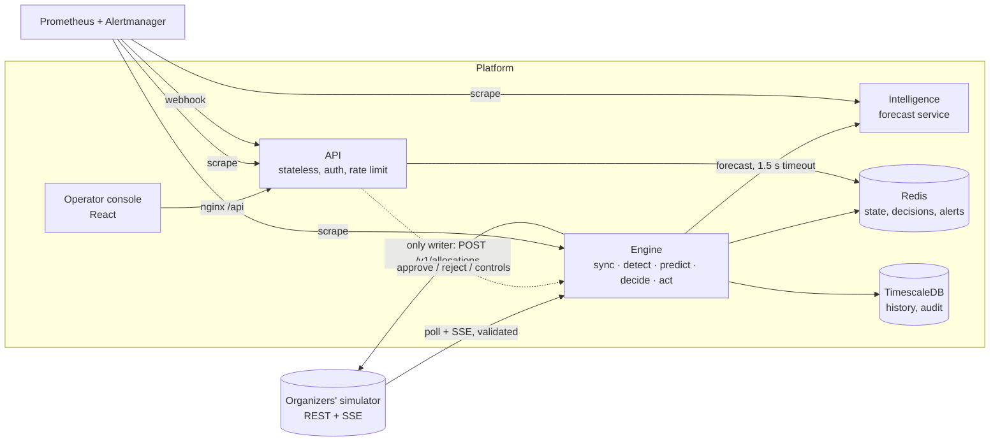

- **One writer:** Only `engine` writes to `POST /v1/allocations` (pinned `replicas: 1` in Kubernetes), and every shipment — optimizer, heuristic, or manual approval — passes `decision/constraints.py`.
- **Intelligence:** Structural seasonal forecaster (`hour-of-day profile × live multiplier`) with 80% conformal intervals; 300-path Monte Carlo risk; CUSUM anomaly detection; rolling-horizon **LP optimizer** (`PuLP + CBC`) with a sub-millisecond heuristic fallback; exact do-nothing counterfactual.
- **Resilience:** `NORMAL / DEGRADED / SAFE_HOLD / NO_FEASIBLE_ROUTES` mode machine, circuit breakers, `GuardedRedis`, buffered TimescaleDB writes, quarantine table for malformed JSON, idempotency keys (`fsip-{run}-{decision}-{line}`), and a static break-glass page at `/breakglass/latest.html`.
- **Stateless API:** Reads engine-published Redis snapshots with content-hash ETag/304 so operator load never touches the engine.

Full details: [docs/architecture.md](docs/architecture.md) · [docs/simulator-facts.md](docs/simulator-facts.md) · [docs/assumptions.md](docs/assumptions.md).

---

## Poridhi Puku CLI Integration & Evaluation

> **Evaluation Reports:** [Poridhi_Puku_CLI_Evaluation_Concise.pdf](docs/evidence/Poridhi_Puku_CLI_Evaluation_Concise.pdf) (2-page summary) · [Full 319-line Markdown Report](docs/evidence/puku-cli-evaluation.md)

### How We Used Puku CLI (`@puku/puku-cli` v1.8.69)
- **`PUKU.md` Auto-Discovery:** Authored [PUKU.md](PUKU.md) in the repository root so Puku CLI automatically ingests FSIP's architecture, safety invariants (`0` failed shipments, `0` overflow), WSL/Docker run commands, and Git branching rules at session start.
- **Terminal SRE & Codebase Auditing:** Used `puku` directly in the terminal for multi-file architectural verification, chaos-drill cross-checking, and live operational triage alongside the web console (documented in [docs/demo-runbook.md](docs/demo-runbook.md) and [docs/ENGINEERING_JOURNAL.md](docs/ENGINEERING_JOURNAL.md)).

### Cold-Start Capability Benchmark (Score: 19 / 20)
We tested Puku CLI cold on the repository (with only `PUKU.md` as upfront context) across four real engineering tasks:
1. **Arrival Overflow Math (`constraints.py`, `planning.py`, `optimizer.py`):** Verified how `room_at_arrival()` accounts for in-flight fuel and the inverted **p10 vs p50** demand asymmetry (`cum10` for overflow, `cum50` for unmet demand).
2. **Crash Idempotency Diagnosis (`repo.py`, Journal B1):** Traced the `sim_runs` TimescaleDB fix for `fsip-{run}-{decision}-{line}` collisions and surfaced an unhandled edge case in prose (closing runs if simulator ticks go backwards).
3. **Algorithm & Fallback Verification (`optimizer.py`, `engine.py`, `heuristic.py`):** Confirmed `PuLP + CBC` 96-tick LP vs RL, off-thread `asyncio.to_thread` execution, and the `confidence < 0.7` human-review fallback gate.
4. **Resilience & Chaos Audit (`docs/evidence/resilience.md`):** Cross-checked all **11 / 11** chaos drills (`0.6–9.1 s` detection, `0.0–25.2 s` unattended recovery) and flagged narrative drift against earlier journal runs.

| Dimension | Score | Verified Against |
|---| :---: |---|
| Context Retrieval | **5 / 5** | Auto-loaded `PUKU.md`; located target Python, React, and shell artifacts in one pass |
| Accuracy | **5 / 5** | Verified exact `file:line` claims across `constraints.py`, `optimizer.py`, and `engine.py` |
| Code Reasoning | **5 / 5** | Connected `p10/p50` overflow asymmetry and `room_now()` vs `room_at_arrival()` across 4 modules |
| SRE Usability | **4 / 5** | Cross-checked 11/11 chaos drill timings (`resilience.md`) and surfaced narrative drift |

**Constructive Feedback Shared for the Poridhi Team:** (1) add a standard operational-surface block to `PUKU.md` (containers, health endpoints, chaos scripts), (2) automatic evidence freshness checks across `docs/evidence/`, (3) structured `invariants.json` verification, (4) a `--verify` citation pre-check before writing reports, and (5) pre-loading domain failure states (`SAFE_HOLD`, `NO_FEASIBLE_ROUTES`, `state.stale`).

---

## Quick Start

Requirements: Docker with Compose v2.24+ (tested on Docker Engine 29 + Compose v5 in WSL2 Ubuntu 24.04), 6 GB RAM.

```bash
git clone https://github.com/ShahriarParib/Bio-Fuel.git && cd Bio-Fuel
cp .env.example .env                 # change tokens before exposing anything
docker compose up -d --build         # simulator, engine, intelligence, api, frontend, TimescaleDB, Redis
bash scripts/smoke_test.sh           # -> SMOKE OK
docker compose --profile obs up -d   # optional: Prometheus, Grafana, Alertmanager, Loki, cAdvisor, node-exporter
```

Verified from scratch via `scripts/clean_clone_test.sh` (stops dev stack, clones fresh from GitHub into an empty folder, runs the commands above — console healthy in ~15 s; [clean-clone.md](docs/evidence/clean-clone.md)).

The simulator starts paused: press **Run** on the Control page (or `curl -X POST localhost:8000/admin/run`).

| URL | Service |
|---|---|
| http://localhost:3000 | **Operator console** (sign in top-right with `API_OPERATOR_TOKEN` or `API_SUPERVISOR_TOKEN` from `.env`) |
| http://localhost:3000/breakglass/latest.html | Static break-glass dispatch plan (works when API/Redis/DB are down) |
| http://localhost:18080/api/docs | Operator API (OpenAPI / Swagger) |
| http://localhost:13001 | Grafana, folder **FSIP** (anonymous viewer enabled) |
| http://localhost:9090 · :9093 | Prometheus · Alertmanager |
| http://localhost:8000/docs | Organizers' Fuel Supply Simulator |

Autopilot (header toggle) executes only when confidence &ge; 70 %, every line &le; 7,000 L, data is fresh, and engine is `NORMAL`. Switch to **ADVISORY** to test manual approvals.

---

## DevOps, Testing & Verification Commands

```
push -> lint + 240 unit tests (Python, TS) -> build images -> e2e on official simulator image -> smoke
     -> browser smoke (real Chromium: routes, panels, Approve reaches simulator)
     -> decision-quality gate (SL >= 0.99, 0 failed shipments, 0 overflow) -> metrics contract -> Trivy
tag v* -> same images pushed to GHCR (:vX.Y.Z, :sha) + CycloneDX SBOMs + keyless cosign -> GitHub Release
deploy -> scripts/deploy.sh vX.Y.Z -> health gate (version, readiness, smoke) -> automatic rollback on failure
```

Branches: every change goes `feature/*` &rarr; `dev` (full verification) &rarr; `main` (always demoable).

| Task | Command |
|---|---|
| Unit tests & lint (240 tests) | `make test` · `make lint` |
| All 11 chaos drills (~15 min) | `make chaos` &rarr; `docs/evidence/resilience.md` |
| Policy evaluation matrix (15 runs) | `.venv/bin/python evaluation/harness.py --matrix` |
| Load test (~8 min, needs `make obs-up`) | `bash loadtest/run_loadtest.sh` |
| Metric contract check | `bash scripts/check_metrics.sh` |
| Software Bill of Materials | `make sbom` &rarr; `sbom/fsip-*.cdx.json` |
| Clean-clone verification | `bash scripts/clean_clone_test.sh` |
| Browser smoke (real Chromium, 19 checks) | `.venv/bin/python scripts/browser_smoke.py` |
| AI assistant, N-1 & fairness evidence | `.venv/bin/python scripts/demo/{assistant,n1,fairness}_evidence.py` |
| Kubernetes: cluster up & proofs | `make k8s-up` · `make k8s-demo` &rarr; `docs/evidence/kubernetes.md` |
| Local release, deploy & rollback demo | `scripts/release_local.sh v1.0.0` · `scripts/deploy.sh v1.0.0 --local` · `scripts/demo/make_bad_release.sh v0.9.9-bad v1.0.0 && scripts/deploy.sh v0.9.9-bad --local` |

---

## Brief Deliverables & Repository Map

| Brief §20 Deliverable | Location |
|---|---|
| Working application | `docker compose up -d --build`, console at `:3000` |
| Source repository | This repo; branches follow `feature/* -> dev -> main` |
| Simulator integration | `services/engine/app/sim/` (client, breaker, SSE, validation), `state/sync.py` |
| Intelligence component | `libs/fsip_common/fsip_common/forecast_seasonal.py`, `services/engine/app/{risk,decision,intelligence}/` |
| Generative AI (grounded) | `libs/fsip_common/fsip_common/llm.py`, `services/api/app/routers/explain.py`, [assistant.md](docs/evidence/assistant.md) |
| Operator interface | `frontend/` (React 18 + TypeScript + Tailwind + TanStack Query) |
| Architecture & Journal | [docs/architecture.md](docs/architecture.md), [FSIP_Full_Engineering_Journal.pdf](docs/FSIP_Full_Engineering_Journal.pdf) |
| Deployment & CI/CD | `docker-compose.yml`, [ci.yml](.github/workflows/ci.yml), `scripts/deploy.sh`, [runbook.md](docs/runbook.md) |
| Kubernetes orchestration | Helm chart `deploy/helm/fsip` + kind cluster, [kubernetes.md](docs/evidence/kubernetes.md) |
| Observability evidence | [observability.md](docs/evidence/observability.md), `observability/` |
| Resilience & Load tests | [resilience.md](docs/evidence/resilience.md), `scripts/chaos/`, [loadtest-report.md](docs/evidence/loadtest-report.md), `loadtest/` |
| Decisions & Reference | [assumptions.md](docs/assumptions.md), [simulator-facts.md](docs/simulator-facts.md), `reference/` |

```
services/engine        control loop: sync, intelligence pipeline, LP/heuristic decision engine, health monitor, SLO
services/intelligence  forecast service (engine carries built-in fallback)
services/api           stateless operator API: auth, rate limit, SSE, Alertmanager webhook, grounded explain, demo controls
libs/fsip_common       shared models, seasonal forecaster, digital twin, grounded LLM client, GuardedRedis
frontend               React + TypeScript + Tailwind charcoal console (nginx serves + proxies /api)
chaos-proxy            corrupts simulator payloads for malformed-data drill (F6)
observability          Prometheus alerts & SLOs, Alertmanager, Loki, Promtail, Grafana dashboards (generated as code)
evaluation             policy evaluation harness and e2e autopilot gate
scripts                smoke, deploy, chaos drills, metric contract, browser smoke, clean-clone test, demo helpers
loadtest               k6 scenarios and automated report generator
deploy                 Helm chart (deploy/helm/fsip) and kind cluster config
reference              baseline/greedy/policy benchmarks and verified simulator semantics scripts
docs                   architecture, runbook, engineering journal (MD + PDF), simulator facts, evidence reports
```
