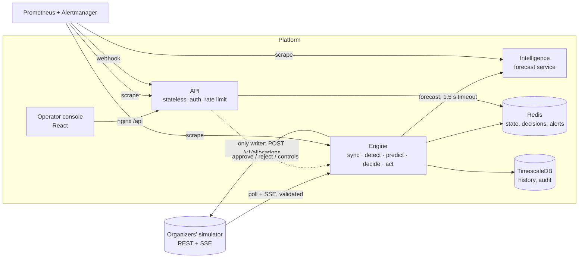

# Fuel Supply Intelligence & Resilience Platform (FSIP)

[](https://github.com/ShahriarParib/Bio-Fuel/actions/workflows/ci.yml)

**BUP CSE FEST 2026, Final Hackathon.** A decision-support platform for the organizers' simulated Bangladeshi fuel
network. It watches the network, predicts shortages, plans shipments under every physical constraint, executes them
with a human in the loop (or on a guarded autopilot), and keeps working when its own dependencies fail.

> SIMULATED ENVIRONMENT. No real fuel infrastructure is accessed or controlled.

## Results (measured, reproducible)

| Question | Answer | Evidence |
|---|---|---|
| Does it help? | 3 simulated days: **31 % → 100 %** of demand served (normal), **26 % → 99 %** (crisis: demand spike + supply cut + two routes cut + supply delay + station outage) | [evaluation.md](docs/evidence/evaluation.md) |
| Does it ever make things worse? | **0 failed shipments and 0 litres lost to overflow** in every scenario and policy | same |
| When fuel truly runs out, is it fair? | the optimizer lifts the worst-served station from 0.87 to 0.92 (6-day baseline) at equal total service | same |
| How early does it warn? | first stockout warning **10 h** before the first stockout; forecast error 5.8 % WAPE vs a 4.5-5.8 % noise floor | [journal B3](docs/ENGINEERING_JOURNAL.md) |
| What if things break? | **11 / 11 failure drills pass**: detected in 0.6-9 s, recovered with no human action in 0-25 s | [resilience.md](docs/evidence/resilience.md) |
| Can I see it? | 4 Grafana dashboards, 16 alerts, 4 SLOs incl. a **domain SLO (fuel service level ≥ 99 %)** | [observability.md](docs/evidence/observability.md) |
| Does it hold load? | k6 through nginx, api ×1 vs ×3, spike to 300 VUs; the engine never falls behind | [loadtest-report.md](docs/evidence/loadtest-report.md) |
| Does it keep itself running? | on Kubernetes: a killed component is replaced in **7 s** while the platform keeps deciding on a labelled fallback, and the api autoscales **2 → 5-6** replicas under a 300-VU spike with **0 5xx** and ~8 ms p95 | [kubernetes.md](docs/evidence/kubernetes.md) |
| Can a non-engineer read it? | any recommendation or incident explains itself in plain words, and a shift ends with a handover note and a postmortem; the model may not invent a number - every figure is checked against ours, and a failed check falls back to our own labelled summary | [assistant.md](docs/evidence/assistant.md) |
| What if one asset fails? | every route, depot and station is removed in turn and the next day replayed with our policy reacting: the worst single failure costs **7,783 L**, and two stations have **no second route at all** | [contingency.md](docs/evidence/contingency.md) |
| When fuel runs short, who suffers? | the console shows every station's own service level, names the worst, and reports the **Jain index**; it also says whether the binding constraint is supply, distribution, or a pending approval | [fairness.md](docs/evidence/fairness.md) |
| Can it be shipped safely? | CI: tests → e2e on the official simulator image → decision-quality gate → Trivy → GHCR, with a **CycloneDX SBOM** per image and **keyless cosign signatures**; `deploy.sh` with health gate and **automatic rollback** | [ci.yml](.github/workflows/ci.yml), [runbook](docs/runbook.md) |

Every number above comes from a script in this repo run against the official simulator image
(`asifmahmoud414/bup-fuel-supply-simulator:1.0.0`). The simulator is deterministic, so re-running gives the same
numbers.

## Quick start

Requirements: Docker with Compose v2.24+ (tested: Docker Engine 29 + Compose v5 in WSL2 Ubuntu 24.04), 6 GB RAM.

```bash
git clone https://github.com/ShahriarParib/Bio-Fuel.git && cd Bio-Fuel
cp .env.example .env                 # change the tokens before exposing anything
docker compose up -d --build         # simulator, engine, intelligence, api, frontend, TimescaleDB, Redis
bash scripts/smoke_test.sh           # → SMOKE OK
docker compose --profile obs up -d   # optional: Prometheus, Grafana, Alertmanager, Loki, cAdvisor, node-exporter
```

Those four lines are exactly what we test: `scripts/clean_clone_test.sh` clones this repository into an empty
directory on a machine with the development stack **stopped**, runs them, and checks the result
([clean-clone.md](docs/evidence/clean-clone.md) — console healthy ~15 s after the containers start).

The simulator starts paused: press **Run** on the Control page, or `curl -X POST localhost:8000/admin/run`.

| URL | What |
|---|---|
| http://localhost:3000 | **Operator console** (sign in top right with `API_OPERATOR_TOKEN` from `.env`) |
| http://localhost:3000/breakglass/latest.html | static dispatch plan that works when everything else is down |
| http://localhost:18080/api/docs | API (OpenAPI) |
| http://localhost:13001 | Grafana, folder FSIP (anonymous viewer) |
| http://localhost:9090 · :9093 | Prometheus · Alertmanager |
| http://localhost:8000/docs | the organizers' simulator |

The simulator starts paused. Press **Run** on the Control page (or `curl -X POST localhost:8000/admin/run`).

## What an operator sees

1. **Overview**: service level, live network graph, stock per station, the **Impact Meter** (an exact replay of the
   same world with nobody acting: litres of stockout prevented).
2. **Recommendations** in the brief's §9 format: station, projected stockout, the shipment, *stockout risk
   before → after*. One click shows why, the constraints respected and the alternative. Approve or reject.
3. **Risk** heatmap (Monte Carlo stockout probability), **Alerts** (explained vs unexplained demand anomalies,
   scheduled disruptions, platform alerts from Prometheus), **Decisions** audit trail.
4. **System Health**: every dependency judged from real traffic, the brief §12 *Resilience Contract* live, incident
   timeline with detect/mitigate/recover times, the domain SLO and its error budget.
5. **Control** (demo): run/pause/step the simulator, inject the organizers' event types and platform faults, and a
   checklist of the brief's §23 demo story.

| Overview | Recommendation with its reasoning |
|---|---|
|  |  |
| **System Health** (resilience contract, incidents, SLO) | **Grafana** during the failure drills |
|  |  |

More: [screenshots](docs/evidence/screenshots/) (risk heatmap, alerts, decisions after an approval, Control page).

Autopilot (header switch) executes a recommendation only if confidence ≥ 70 %, every line ≤ 7,000 L, the data is fresh
and the engine is NORMAL. Otherwise it waits for a human.

## How it works



- **One writer.** Only the engine writes to the simulator, and every shipment passes `decision/constraints.py`: depot
  stock, per-depot dispatch capacity shared across fuels, route capacity, station capacity *at arrival* including
  fuel already on the way (p10 demand), and routes disrupted now **or at departure**.
- **Intelligence.** A structural seasonal forecaster (hour-of-day profile × the simulator's demand multiplier × an
  adaptive level) with calibrated 80 % intervals; Monte Carlo stockout risk; CUSUM anomaly detection that separates
  demand explained by a known event from unexplained drift; a rolling-horizon **LP optimizer** (PuLP + CBC) with a
  heuristic fallback; an exact do-nothing counterfactual for the Impact Meter.
- **Resilience.** Health judged from real traffic, never from the simulator's `/v1/health` (which ignores injected
  faults). Mode machine NORMAL / DEGRADED / SAFE_HOLD / NO_FEASIBLE_ROUTES, circuit breakers, last-good state,
  fallback forecaster, buffered history writes, idempotency keys, break-glass page.
- **Stateless API.** Reads what the engine publishes to Redis (ETag/304), so API load never reaches the engine.

Details: [docs/architecture.md](docs/architecture.md). The full engineering story, including every bug the drills
found: [docs/ENGINEERING_JOURNAL.md](docs/ENGINEERING_JOURNAL.md).

## Things we found that change the design

Measured on the simulator image, each with a test or a drill (details in the journal):

- `/v1/health` stays "ok" while every real call fails under fault injection, so health must come from real traffic.
- A shipment created when a route disruption starts at its departure tick is **lost** (FAILED, no refund); a
  disruption that starts mid-transit has no effect. So the planner checks the route at departure, not "now".
- Arrival overflow is silently lost and the simulator's capacity check ignores fuel already in transit. So the planner
  projects inventory at arrival, in-flight fuel included, using pessimistic (p10) demand.
- Dispatch capacity is per depot per tick **across all fuels**; supply arrivals end at tick 212; a closed station sells
  nothing but its inventory does not fall; the `stream_disconnect` fault only refuses new SSE connections.
- Our own drills found and fixed: a degraded flag that silently disabled autopilot after any outage, a circuit
  breaker that treated a flaky dependency as dead, a dead Redis starving DNS for healthy dependencies, and an
  error-budget policy that switched off the remedy (service level 99 % → 81 %).

## DevOps

```
push → lint + unit (Python, TypeScript) → build images → e2e on the official simulator image → smoke
     → browser smoke (real Chromium: routes, panels, Approve reaches the simulator)
     → decision-quality gate (SL ≥ 0.99, 0 failed shipments, 0 overflow) → metrics contract → Trivy
tag v* → the same images pushed to GHCR (:vX.Y.Z, :sha) → GitHub Release with the evidence reports
deploy → scripts/deploy.sh vX.Y.Z → health gate (version, readiness, smoke) → automatic rollback on failure
```

Branches: every change goes `feature/*` → `dev` (full check) → `main` (always demoable).

| Task | Command |
|---|---|
| unit tests · lint | `make test` · `make lint` |
| all resilience drills (~15 min) | `make chaos` → `docs/evidence/resilience.md` |
| policy evaluation matrix (~35 min) | `.venv/bin/python evaluation/harness.py --matrix` |
| load test (~8 min, needs `make obs-up`) | `bash loadtest/run_loadtest.sh` |
| metric contract | `bash scripts/check_metrics.sh` |
| software bill of materials | `make sbom` → `sbom/fsip-*.cdx.json` |
| clean-clone test (what a judge runs) | `bash scripts/clean_clone_test.sh` |
| browser smoke (real Chromium, 19 checks) | `.venv/bin/python scripts/browser_smoke.py` |
| assistant evidence | `.venv/bin/python scripts/demo/assistant_evidence.py` |
| N-1 contingency evidence | `.venv/bin/python scripts/demo/n1_evidence.py --inject` |
| fairness evidence | `.venv/bin/python scripts/demo/fairness_evidence.py` |
| Kubernetes: cluster up · the two proofs | `make k8s-up` · `make k8s-demo` → `docs/evidence/kubernetes.md` |
| release locally · deploy · rollback demo | `scripts/release_local.sh v1.0.0` · `scripts/deploy.sh v1.0.0 --local` · `scripts/demo/make_bad_release.sh v0.9.9-bad v1.0.0 && scripts/deploy.sh v0.9.9-bad --local` |

## Brief deliverables → where

| Brief §20 | Where |
|---|---|
| Working application | `docker compose up -d --build`, console at :3000 |
| Source repository | this repo; history follows feature → dev → main |
| Simulator integration | `services/engine/app/sim/` (client, breaker, SSE, validation), `state/sync.py` |
| Intelligence component | `libs/fsip_common/fsip_common/forecast_seasonal.py`, `services/engine/app/{risk,decision,intelligence}/` |
| Generative AI (optional) | `libs/fsip_common/fsip_common/llm.py`, `services/api/app/routers/explain.py`, [assistant.md](docs/evidence/assistant.md) |
| Operator interface | `frontend/` |
| Architecture | [docs/architecture.md](docs/architecture.md) |
| Deployment | `docker-compose.yml`, [ci.yml](.github/workflows/ci.yml), `scripts/deploy.sh`, [runbook](docs/runbook.md) |
| Orchestration (optional) | Helm chart `deploy/helm/fsip` + kind cluster, [kubernetes.md](docs/evidence/kubernetes.md) |
| Observability evidence | [observability.md](docs/evidence/observability.md) |
| Resilience demonstration | [resilience.md](docs/evidence/resilience.md), `scripts/chaos/` |
| Load-test evidence | [loadtest-report.md](docs/evidence/loadtest-report.md), `loadtest/` |
| Decisions and deviations | [assumptions.md](docs/assumptions.md), [ENGINEERING_JOURNAL.md](docs/ENGINEERING_JOURNAL.md) |

## Repository

```
services/engine        control loop: sync, intelligence pipeline, decision engine, health monitor, SLO
services/intelligence  forecast service (the engine has a built-in fallback)
services/api           operator API: auth, rate limit, SSE, Alertmanager webhook, demo controls
libs/fsip_common       shared models, forecaster, Redis guard
frontend               React + TypeScript + Tailwind console (nginx serves it and proxies /api)
chaos-proxy            corrupts simulator payloads for the malformed-data drill
observability          Prometheus rules (alerts, SLOs), Alertmanager, Loki, Promtail, Grafana dashboards (generated)
evaluation             policy evaluation harness and the e2e autopilot test
scripts                smoke, deploy, chaos drills, metric contract, demo helpers
loadtest               k6 scenarios and the report generator
deploy                 Helm chart and kind cluster config for the Kubernetes deployment
docs                   architecture, runbook, journal, assumptions, evidence
```
