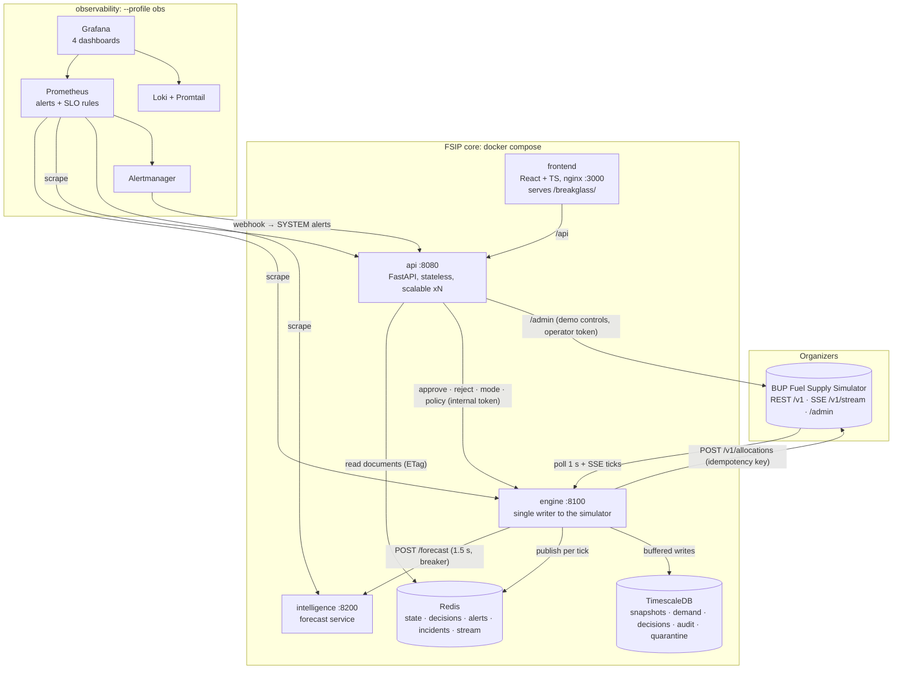
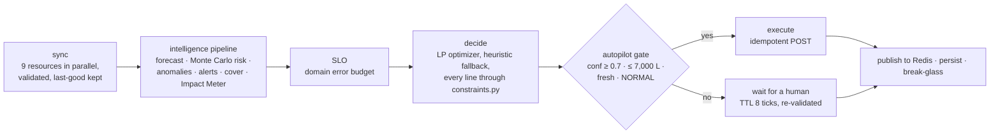
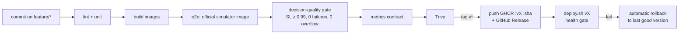

# Architecture

## 1. Components

| Service | Responsibility | Why separate |
|---|---|---|
| **engine** | the control loop; the only process that writes to the simulator | one writer = no double shipments, one place for every constraint |
| **intelligence** | demand forecast service | can fail or be replaced without stopping decisions (the engine has a built-in fallback) |
| **api** | operator API: auth, rate limit, SSE, Alertmanager webhook, demo controls | stateless: scales with replicas, never adds load to the engine |
| **frontend** | console, served by nginx, which also serves the static break-glass plan | works even when the api is down (break-glass) |
| Redis | the live documents the api serves; the domain event stream | cheap reads at any load; if it dies the api reads from the engine directly |
| TimescaleDB | history and audit | writes are buffered: the engine keeps running when the DB is down |

## 2. The control loop (engine, every simulator tick)

Alongside, every second, the **HealthMonitor** judges each dependency from real traffic (breaker state, error ratio
and p95 of the last 30 s, the stale header, DB/Redis probes) and drives the mode machine:

| Mode | Entered when | Effect |
|---|---|---|
| NORMAL | everything up | autopilot allowed |
| DEGRADED | any component not up, or stale data | autopilot suspended; recommendations need a human |
| SAFE_HOLD | simulator down ≥ 60 s | no writes; cached state shown with its true age |
| NO_FEASIBLE_ROUTES | every route to some station is cut (now or at departure) | the operator is told which station is unreachable |

## 3. Decisions: the constraints every shipment must pass (`services/engine/app/decision/constraints.py`)

| Constraint | Simulator behaviour it protects against (measured) |
|---|---|
| route not disrupted now **and not at departure** (t, t+1) | disruption starting at the departure tick → FAILED, fuel lost, no refund |
| station room **at arrival** ≥ quantity, using p10 demand and every in-flight shipment | arrival overflow is silently lost; the simulator's own check ignores in-flight fuel |
| per-depot dispatch capacity per tick, shared across fuels (halved when CONSTRAINED) | 409 DISPATCH_CAPACITY |
| depot stock, route max shipment, station open | 409s |
| minimum line size 300 L (unless critical) | noise shipments |

The optimizer (PuLP + CBC) plans a rolling horizon but only the first tick is executed; its output still passes the
same checks, so it can never be less safe than the heuristic. On any solver error the heuristic answers and the
recommendation is tagged "fallback policy".

## 4. Failure handling (brief §12)

| Failure | Detection | Automatic response |
|---|---|---|
| simulator down / 503 | breaker OPEN from real calls | cached last-good state with its age, no writes, SAFE_HOLD after 60 s, half-open probes |
| simulator flaky / slow | 30 s error ratio, p95 | retries with backoff (breaker counts failed requests, not attempts), 2 s timeout |
| stale data | `x-simulator-stale` header | autopilot paused, approvals blocked |
| malformed payload | pydantic validation | rejected, stored in `quarantine`, last-good kept, alert names the field |
| SSE stream down | connection state | 1 s polling keeps the loop going; reconnect with backoff |
| prediction service down | breaker, output validation | built-in seasonal forecaster, confidence 0.6 (human review) |
| optimizer fails | exception / timeout | heuristic for that cycle |
| DB down | probe, write errors | writes buffered (5,000), decisions get local ids, 2 s timeouts so the cycle never stalls |
| Redis down | probe | api reads the engine directly; fail-fast guard so DNS lookups for the dead host do not starve the rest |
| engine crash | container restart | state rebuilt from the simulator and the DB; idempotency keys prevent duplicates |
| simulator reset | tick goes back / new seed | new run id, state cleared, history kept |
| everything down | — | static break-glass plan (nginx) |

Every row has a drill in `scripts/chaos/`; results in `docs/evidence/resilience.md`.

## 5. Observability and SLOs

Metrics `fsip_*` (engine, intelligence), `http_*` (api), cAdvisor, node-exporter → Prometheus (5 s) → 16 alert rules +
4 SLOs with multi-window burn-rate alerts → Alertmanager → api webhook → SYSTEM alerts in the console. JSON logs →
Promtail → Loki. Dashboards are generated from code (`observability/grafana/gen_dashboards.py`).

The **domain SLO** is "fuel service level ≥ 99 % over one simulated day". Its error-budget policy, enforced by the
engine itself: under 25 % budget → change freeze (policy switches need an audit-logged override; chaos injects need
a supervisor) and operators are paged. Autopilot keeps running, because shipments are the remedy, not the risk.

## 6. Delivery

Branches: `feature/*` → `dev` (rebuild + full check) → `main` (always demoable).

## 7. Tech

Python 3.12 (FastAPI, httpx, pydantic 2, SQLAlchemy 2 async, PuLP/CBC, numpy), React 18 + TypeScript + Tailwind +
TanStack Query, TimescaleDB 2.17 (PG16), Redis 7.4, Prometheus 2.55, Alertmanager 0.27, Grafana 11.2, Loki/Promtail 3.2,
k6 0.54, Docker Compose, GitHub Actions, Trivy, GHCR. All versions pinned.
