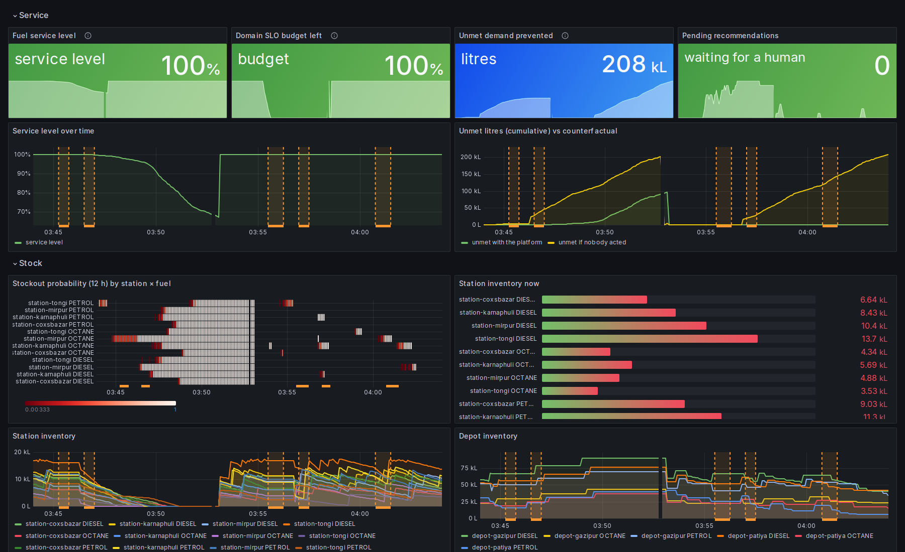
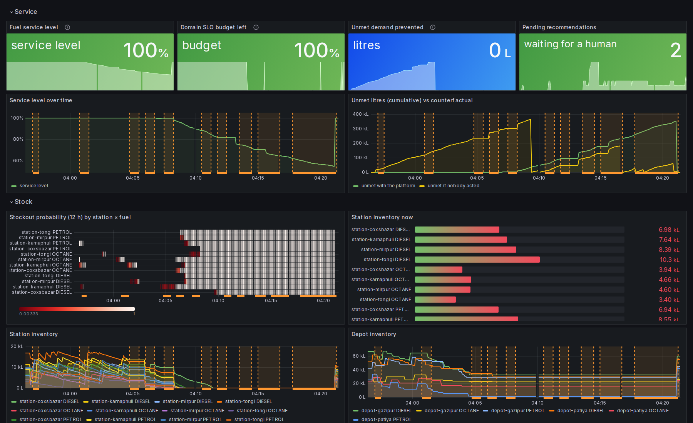
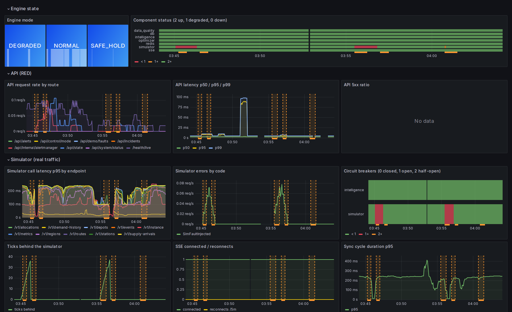
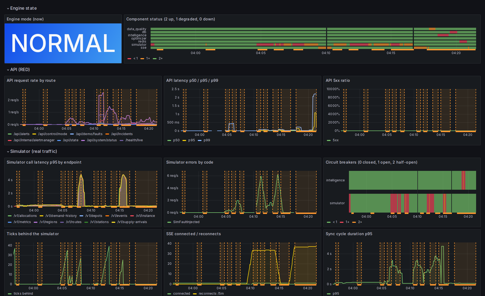
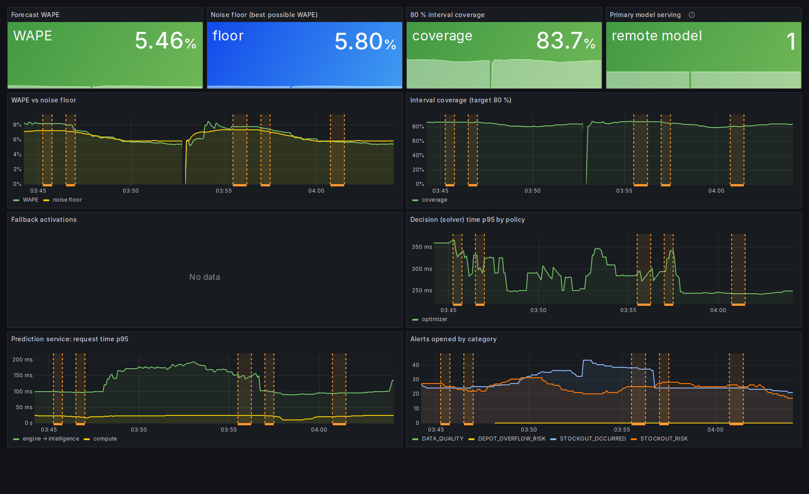
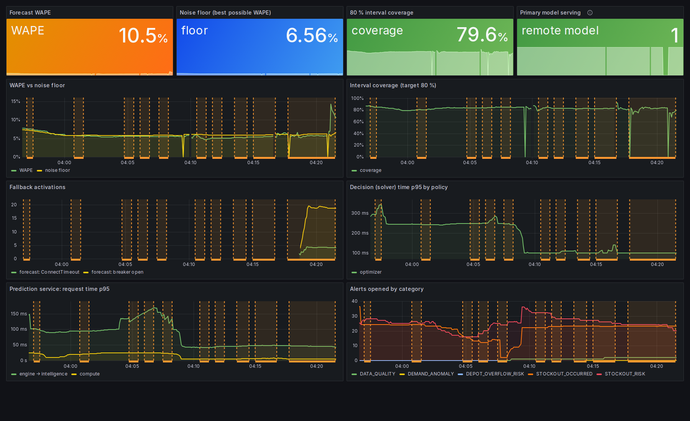
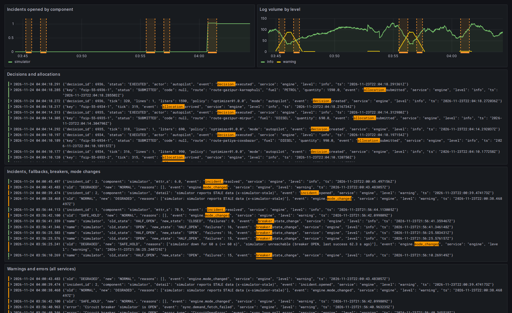
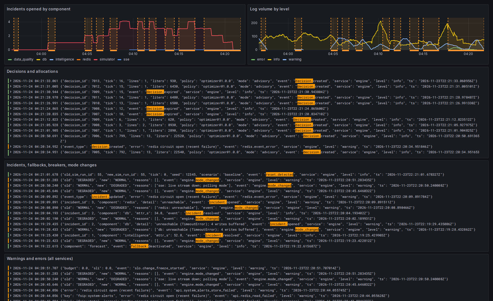
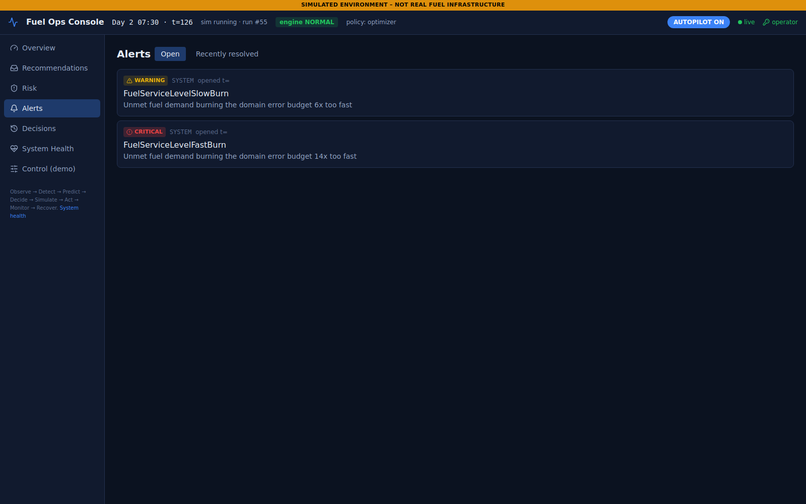
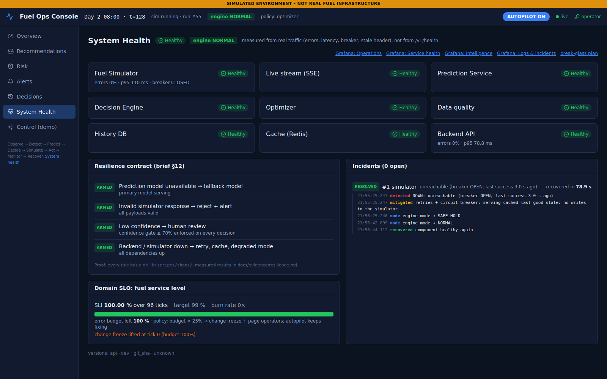

# Observability evidence (B7)

Start: `make obs-up` (core stack + Prometheus, Grafana, Alertmanager, Loki, Promtail, cAdvisor, node-exporter).
Grafana: http://localhost:13001 (anonymous viewer), folder **FSIP**. Prometheus :9090, Alertmanager :9093, Loki :3100.

## What is measured

| Layer | Source | Examples |
|---|---|---|
| Domain (is fuel reaching people?) | engine, from the simulator's ground truth | `fsip_service_level`, `fsip_sim_unmet_liters`, `fsip_stockout_prob{station,fuel}`, `fsip_station_inventory_liters`, `fsip_inflight_liters`, `fsip_unmet_prevented_liters` (Impact Meter) |
| Dependencies, from real traffic | engine | `fsip_sim_request_duration_seconds`, `fsip_sim_errors_total{code}`, `fsip_breaker_state`, `fsip_component_status`, `fsip_engine_mode`, `fsip_ticks_behind`, `fsip_stale_data` |
| Intelligence | engine + intelligence | `fsip_forecast_wape` vs `fsip_forecast_noise_floor_wape`, `fsip_forecast_interval_coverage`, `fsip_fallback_activations_total`, `fsip_decision_plan_seconds{policy}` |
| API (RED) | api | `http_requests_total{route,status}`, `http_request_duration_seconds` |
| Containers / host | cAdvisor, node-exporter | CPU, memory per compose service |
| Logs | Promtail → Loki (JSON, labels `service`, `level`, `event`) | `{service="engine"} \|= "decision.created"` |

`scripts/check_metrics.sh` fails the build if any metric the dashboards, alerts or SLOs use is missing:

```
OK   engine: 39 metrics present
OK   api: 2 metrics present
OK   intelligence: 3 metrics present
OK   prometheus: all targets up
OK   prometheus: 4 SLO budgets recorded
OK   prometheus: all rules healthy
METRICS OK
```

## SLOs (`observability/prometheus/slo.yml`)

| SLO | SLI | Target | Alerts |
|---|---|---|---|
| API availability | non-5xx / all api requests | 99.5 % | fast burn 14.4× (5m and 1h), slow burn 6× (30m and 6h) |
| API latency | `/api/state` requests under 250 ms | 99 % | fast burn |
| Decision freshness | engine ≤ 2 ticks behind the simulator | 99 % | fast burn |
| **Fuel service level (domain)** | served / (served + unmet) litres | **99 %** | fast + slow burn |

**Error-budget policy** (enforced by the engine itself, `services/engine/app/state/slo.py`, so it works even if
Prometheus is down): when less than 25 % of the domain budget is left, a **change freeze** starts: switching the
decision policy needs an explicit, audit-logged override and fault injection (chaos) needs a supervisor. Operators are
paged by the burn-rate alerts. **Autopilot keeps running**: recovery shipments are the fix, not the risk. The first
version switched autopilot off; the outage drill below showed why that is wrong.

## Alert path, measured

75 s simulator outage (`unavailable` fault) with autopilot on:

- Prometheus `SimulatorDown` (breaker OPEN) and `EngineSafeHold` fired → Alertmanager → api webhook → shown on the
  console's Alerts page as SYSTEM alerts → resolved by themselves after recovery.
- Service level before / during / after: 100 % / 100 % / 100 % (stations had stock; shipments resumed as soon as the
  simulator answered; zero recommendations left waiting).

Two drills that changed the code:

| Run | What happened | Fix |
|---|---|---|
| Policy v1 "budget < 25 % → autopilot off" | the outage spent the budget; autopilot was switched off when the simulator came back; nobody approved; service level 99 % → 81 % | change freeze instead of switching the remedy off |
| After fix 1 | service level still fell 99 % → 87 %: 8 recommendations waiting at confidence 0.5 | a `demand_fetch_failed` flag set during the outage never cleared, so autopilot's confidence gate stayed shut while health said NORMAL. Cleared on success; drills now require trusted decision inputs to count as recovered |

## Dashboards (generated: `python observability/grafana/gen_dashboards.py`)

| Dashboard | Autopilot through two 75 s outages | During the 11 resilience drills (25 min, advisory: nobody refilling) |
|---|---|---|
| Operations Overview |  |  |
| Service Health |  |  |
| Intelligence |  |  |
| Logs & Incidents |  |  |

The orange dashed markers are engine mode changes (annotations): every drill shows as a detect → recover pair.

Console during the drill:  

## Loki query examples

```
{service="engine"} |= "decision.created" | json | line_format "{{.tick}} {{.policy}} {{.liters}} L"
{service="engine"} |~ "incident\\.|breaker\\.|mode_changed"
{level=~"warning|error"}
```
